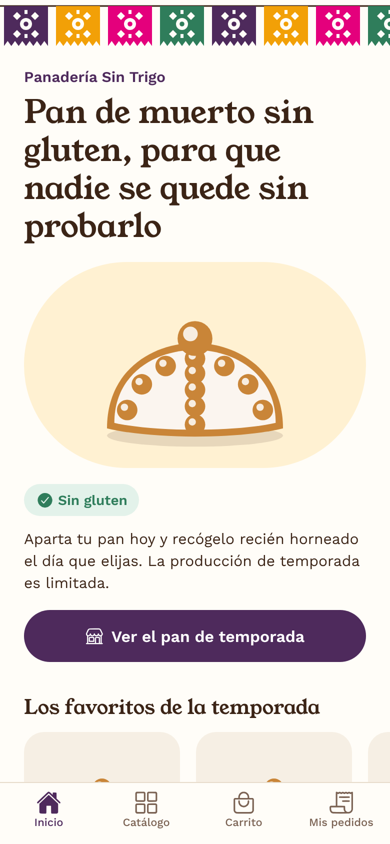
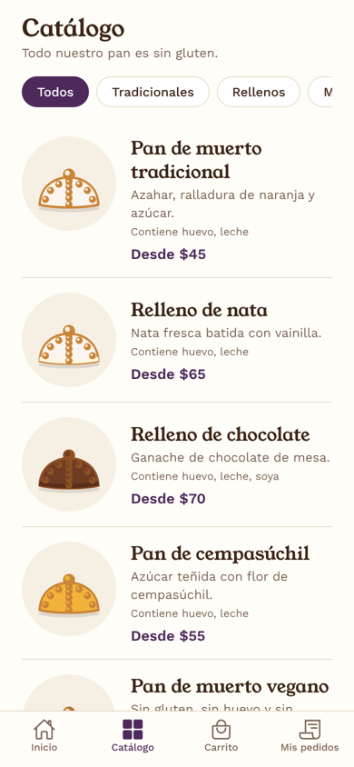
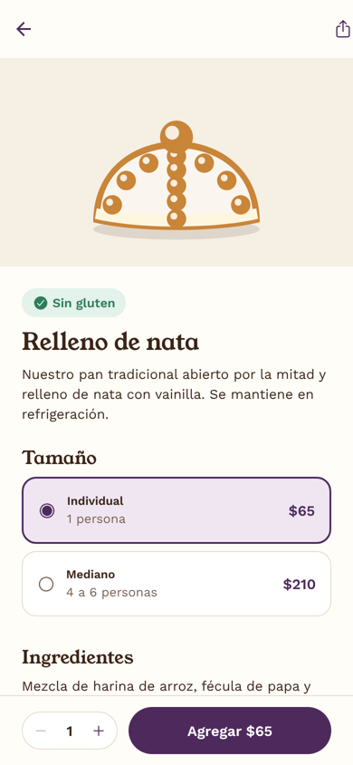
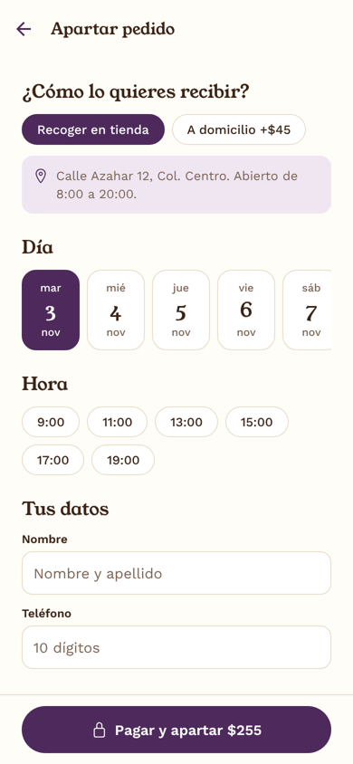
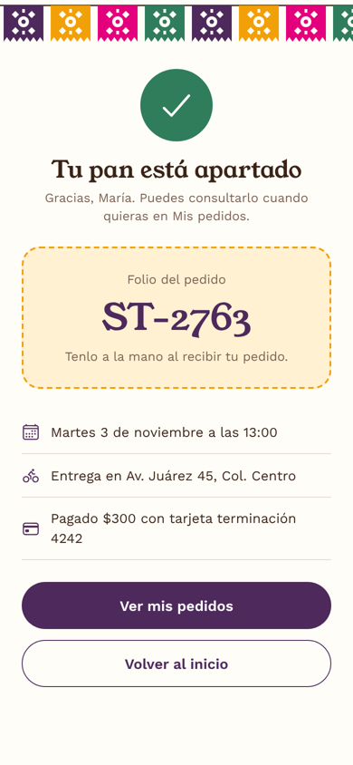

# Panadería Sin Trigo

Aplicación móvil en React Native (Expo) para que una panadería especializada en pan sin gluten venda su pan de muerto por **preventa**: el cliente elige sus panes, aparta el día y la hora de entrega y paga desde el teléfono.

<p>
  
  
  
  
  
</p>

## Problema

La panadería solo vende en mostrador. Eso limita sus ventas en la temporada más fuerte del año (Día de Muertos) por tres razones:

- Las personas celíacas no confían fácilmente en un pan "sin gluten" si no ven la información de ingredientes y de cómo se elabora.
- La producción es limitada y no se sabe con anticipación cuánto hornear. Si se acaba, se pierden ventas; si sobra, se pierde producto.
- Solo compra quien pasa por la tienda.

## Solución

| Funcionalidad | Cómo ayuda a vender más |
| --- | --- |
| Catálogo con filtros (tradicionales, rellenos, minis) | El cliente ve toda la oferta y los precios desde el teléfono. |
| Ficha de cada pan con ingredientes, alérgenos y sello "Sin gluten" | Da confianza a personas celíacas y con otras alergias. Es el principal diferenciador de la panadería. |
| Varios tamaños por pan | Aumenta el ticket promedio (individual, mediano, familiar). |
| Carrito con sugerencias "Completa tu ofrenda" | Venta cruzada de productos que todavía no están en el carrito. |
| Preventa con día y hora de entrega | La panadería sabe qué hornear y el cliente asegura su pan. |
| Recoger en tienda o envío a domicilio | Llega a clientes que no pueden ir a la tienda. |
| Pago en la app (simulado) | El pedido queda pagado y apartado; menos cancelaciones. |
| Botón de compartir en cada pan | Difusión de boca en boca por WhatsApp y redes sociales. |
| Mis pedidos con folio | El cliente consulta su pedido cuando quiera y lo presenta al recoger. |

## Pantallas

1. **Inicio**: presentación de la panadería, favoritos de la temporada, cómo funciona la preventa y garantías para celíacos.
2. **Catálogo**: lista de panes con filtro por categoría.
3. **Detalle**: tamaño, ingredientes, alérgenos, cantidad y botón para agregar al carrito.
4. **Carrito**: cantidades, subtotal y sugerencias.
5. **Apartar pedido**: modalidad de entrega, día, hora, datos de contacto y pago simulado.
6. **Confirmación**: folio del pedido y resumen.
7. **Mis pedidos**: historial guardado en el teléfono.

## Tecnologías

- [Expo](https://expo.dev) (SDK 58) con JavaScript
- React Navigation: pestañas inferiores y navegación en pila
- Context API para el estado global (carrito y pedidos)
- AsyncStorage para guardar los pedidos en el teléfono
- react-native-svg para las ilustraciones (pan de muerto y papel picado)
- Tipografías Young Serif y Work Sans (`@expo-google-fonts`)

Los datos del catálogo son locales (`src/data/products.js`); no hay backend.

## Cómo ejecutarlo

Requisitos: Node.js 20 o superior y la app **Expo Go** en el teléfono.

```bash
npm install
npx expo start
```

Escanea el código QR con la cámara (iOS) o con Expo Go (Android). También puedes presionar `a` para abrir un emulador de Android o `w` para verlo en el navegador.

### Pago de prueba

El pago es una simulación: no se realiza ningún cargo. En la pantalla de pago toca **Usar tarjeta de prueba** para llenar los datos automáticamente.

## Estructura del proyecto

```
App.js                      Navegación y carga de fuentes
src/
  theme.js                  Colores, tipografías y espaciado
  data/products.js          Catálogo, garantías y costo de envío
  context/TiendaContext.js  Carrito y pedidos (con AsyncStorage)
  utils/format.js           Formato de precios, fechas y folios
  components/
    PanIlustracion.js       Pan de muerto dibujado en SVG
    PapelPicado.js          Guirnalda de papel picado en SVG
    ProductoCard.js         Tarjetas del catálogo y de destacados
    ui.js                   Botón, contador, chip y sello "Sin gluten"
  screens/                  Una pantalla por archivo
```

## Diseño

- **Paleta**: tomada del pan y de la ofrenda. Fondo color azúcar, texto color cacao, morado de altar como color de marca, cempasúchil como acento y verde para todo lo relacionado con "sin gluten".
- **Tipografía**: Young Serif para títulos (cálida, de panadería) y Work Sans para el texto (legible en pantallas pequeñas).
- **Elemento distintivo**: el papel picado y las ilustraciones de pan de muerto, dibujadas en SVG y coloreadas según cada producto.

## Alcance y mejoras futuras

Fuera del alcance de esta práctica (una semana de desarrollo):

- Backend real con inventario por día y cupo de pedidos por horario.
- Cuentas de usuario.
- Pasarela de pago real (Stripe, Mercado Pago).
- Notificaciones push para recordar la entrega.
- Panel de administración para la panadería.
